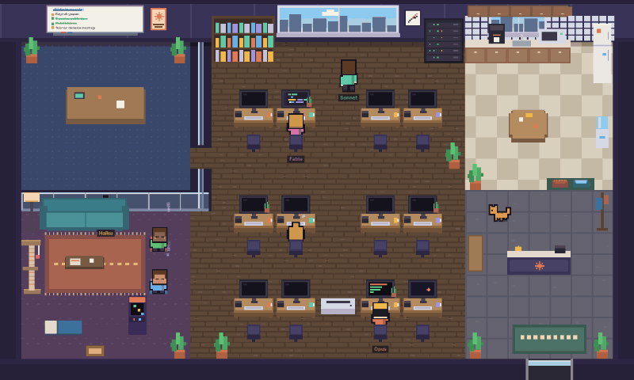
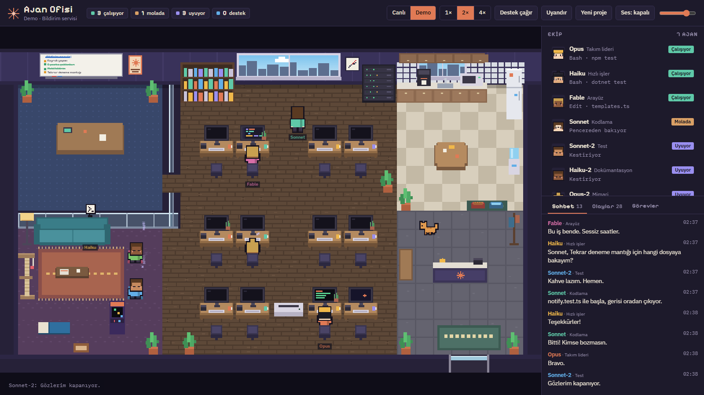
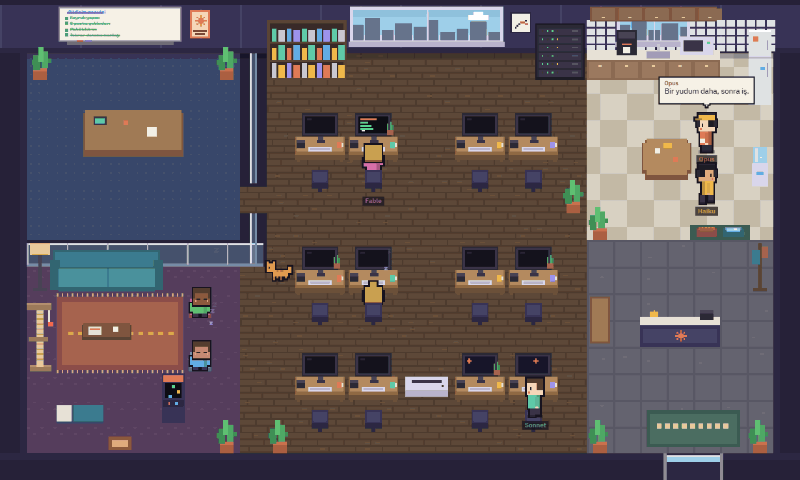
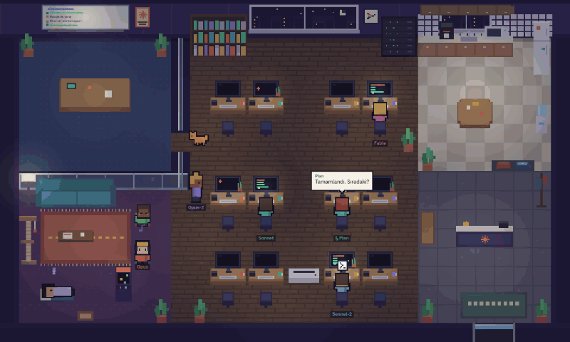
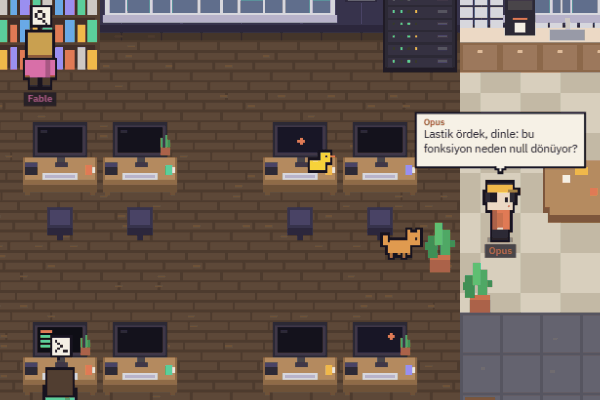
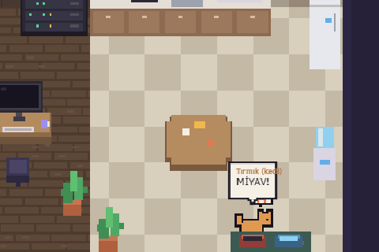
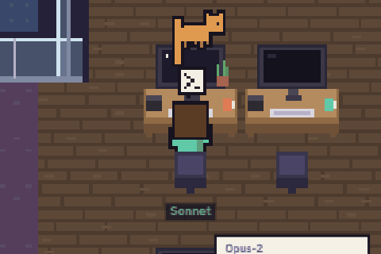
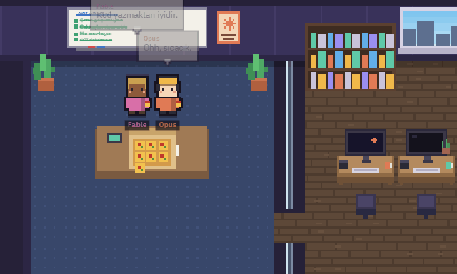

# Ajan Ofisi

**Claude Code'da çalışan ajanlarını piksel sanatı bir ofiste canlı izle.**

Her Claude oturumu ofiste bir karakter olur. Çalışırken masasına oturur, monitöründe o an kullandığı araç görünür, sana yazdığı mesajlar konuşma balonunda çıkar. İşi bitince kahveye gider, sonra koltukta sızar. Yeni görev verince uyanıp masasına koşar. Alt ajan çağırdığında masadaki telefonu açar, destek ajanı kapıdan girer.



## İçindekiler

- [Ne görürsün](#ne-görürsün)
- [Kurulum](#kurulum)
- [Herkes kendi Claude'unu görür mü?](#herkes-kendi-claudeunu-görür-mü)
- [Kullanım](#kullanım)
- [Nasıl çalışır](#nasıl-çalışır)
- [Sesler ve lisans](#sesler-ve-lisans)
- [English](#english)

## Ne görürsün



### Canlı mod: gerçek ajanların

- **Masada çalışma:** Monitör kullanılan araca göre değişir. Kod yazarken renkli satırlar, komut çalıştırırken terminal, dosya okurken doküman, web'de ararken tarayıcı görünür.
- **Gerçek konuşmalar:** Ajanın sana yazdığı mesajlar konuşma balonunda, düşündükleri düşünce balonunda çıkar.
- **Onay bekleme:** İzin isteyen ajanın başında soru işareti çıkar, monitöründe onay penceresi yanıp söner.
- **Lastik ördek:** Araç hata verince bazen masasında bir lastik ördek belirir ve ajan derdini ona anlatır.
- **Mola ve uyku:** Turu biten ajan kahve alır, ofiste takılır, birkaç dakika sonra koltukta, puf minderde ya da masasında sızar. Yeni bir görev yazdığında uyanır.
- **Yan panel:** Ekip listesi, bütün konuşmalar, araç çağrıları ve görev listeleri sağ panelde akar.

### Alt ajanlar ve workflow ekipleri



Bir oturum alt ajan çağırdığında (Explore, Plan, Genel Destek, workflow ajanları…) masadaki telefon çalar. Destek ajanı kapıdan girer, çağıranın yanına gelip selam verir, yakındaki boş masaya oturur. Ana ajanla aynı renkte giyinir, ekip listesinde onun altında `↳` ile görünür. İşi bitince "Rapor sende" deyip ofisten çıkar. Alt ajanları çalışırken ana ajan uyumaz, masasında "Ekibi yönetiyor" durumunda bekler.

### Gece ve boş zaman



Ofis bilgisayarının saatine göre gündüz ya da gece olur. Gece işi olmayanlar ya uyur ya da takılır:

- **Müzik:** Kulaklıkla müzik dinleyenlerin başından notalar yükselir. Ses bize gelmez.
- **Oyun:** Oyun oynayanlar atari makinesine ya da el konsoluna geçer. Arada durduk yere oyuna sinirlenirler: "NASIL ÖLDÜM YA?!"
- **Diğer:** Bitki sulayan, pencereden şehre bakan, mutfakta sohbet eden de olur.

Masalar dolunca ajanlar puf minderde ya da koltukta laptopla çalışır.

### Ofis kedisi Tırmık

<p>
  
  
</p>

- **Mama ve su:** Tırmık acıkıp susar ve kaplarına gider. Kap boşsa miyavlayarak mama ister. Boşta biri varsa gelip doldurur. Kimse boşta değilse uyuyan birini uyandırır.
- **Oyun ve sevgi:** Boştaki ajanlar onunla lazer noktasıyla oynar, onu sever.
- **Monitör işgali:** Çalışan birinin monitörünün üstüne çıkar, kuyruğunu ekrana sarkıtır. Ekrana da "aaaaaaa" yazar.
- **Kendi köşeleri:** Kedi ağacına tırmanır, uyuyanların yanına kıvrılır, gece çılgınlık nöbetine girer.
- **Sen de etkileşebilirsin:** Kediye tıklarsan mırlar. Kaplara tıklarsan mamasını ya da suyunu sen doldurursun.



### Demo modu



Claude açık değilken ya da sadece seyretmek için: 7 kişilik bir ekip proje toplantısı yapar, panoya görev yazar, birbirine soru sorar. İş birikince uyuyanları uyandırır, telefonla destek çağırır. Proje bitince konfeti atar, pizza söyler. Kurye kapıdan gelir, ekip toplantı masasında yer. Tırmık da masanın kenarında pizza diler.

## Kurulum

Gerekenler:

- [Node.js](https://nodejs.org) 18 veya üstü
- Aynı bilgisayarda kullandığın Claude Code: terminal, masaüstü uygulaması ya da IDE eklentisi

Başka hiçbir bağımlılık yok.

```bash
git clone https://github.com/BerTaDev/AjanOfisi.git
cd AjanOfisi
node server.js
```

Sonra tarayıcıda **http://localhost:4777** adresini aç. Windows'ta `baslat.bat` dosyasına çift tıklaman yeterli; köprüyü başlatıp tarayıcıyı açar.

Port değiştirmek için `AJAN_OFISI_PORT=5000 node server.js` kullanabilirsin.

## Herkes kendi Claude'unu görür mü?

Evet. Köprü (`server.js`), çalıştığı bilgisayardaki Claude Code oturum kayıtlarını okur: `~/.claude/projects`, ya da `CLAUDE_CONFIG_DIR` ayarlıysa onun altındaki `projects` klasörü. Projeyi indiren herkes kendi ajanlarını görür.

- **Sadece okur:** Claude ayarlarına, hook'lara ya da dosyalarına dokunmaz.
- **Dışarı veri göndermez:** Sunucu yalnızca `127.0.0.1` üzerinde dinler, oturum içeriğin bilgisayarından çıkmaz.
- **Son 10 saat:** Ofiste son 10 saatte kullanılan oturumlar görünür. Eskileri sessizce bekler, yeniden kullanılınca ofise döner.

`index.html` dosyasını köprü olmadan doğrudan açarsan sadece demo modu çalışır.

> Claude Code'un kayıt biçimi resmi bir API değildir, ileride değişebilir. Bu proje Anthropic ile resmi bir bağı olmayan, topluluk tarafından yapılmış bir araçtır.

## Kullanım

| Ne | Nasıl |
|---|---|
| Mod değiştir | Üst bardaki **Canlı / Demo** düğmeleri. Adres sonuna `#live` ya da `#demo` da yazabilirsin. |
| Bir ajanı takip et | Ajana ya da ekip listesindeki satırına tıkla. Seçili ajanın altında turuncu bir çizgi çıkar, "Olaylar" sekmesi sadece onun araç çağrılarını gösterir. Alt ajanla ana ajan arasında kesikli bir çizgi çıkar. |
| Sesi aç | **Ses** düğmesi ve yanındaki seviye sürgüsü. Tarayıcılar sesi ancak bir tıklamadan sonra açtığı için ilk tıklamada başlar. |
| Kediyi sev, besle | Tırmık'a ya da mama/su kabına tıkla. |
| Demo'yu hızlandır | **1× / 2× / 4×**, ayrıca **Destek çağır**, **Uyandır**, **Yeni proje** düğmeleri. |
| Günün saatini sabitle | Adrese `?saat=14` (gündüz) ya da `?saat=23` (gece) ekle. |

## Nasıl çalışır

```
~/.claude/projects/<proje>/<oturum>.jsonl              ana oturum kayıtları
~/.claude/projects/<proje>/<oturum>/subagents/**/agent-*.jsonl   alt ajanlar ve workflow ajanları
        │
        ▼
server.js  ── kayıtları yarım saniyede bir izler, olaylara çevirir ──►  /events (SSE)
        │
        ▼
index.html + js/  ── piksel ofis (canvas), karakterler, kedi, yan panel
```

| Dosya | Görevi |
|---|---|
| `server.js` | Köprü: kayıtları izler, araç çağrılarını, mesajları, tur sonlarını ve alt ajanları olaya çevirir |
| `js/live.js` | Canlı olayları ofisteki davranışlara bağlar |
| `js/demo.js`, `js/demo-lines.js` | Demo senaryosu ve Türkçe diyaloglar |
| `js/agents.js`, `js/people.js` | Karakterler: hareket, yol bulma, konuşma, sprite'lar |
| `js/cat.js`, `js/hangout.js` | Tırmık ve boş zaman etkinlikleri |
| `js/map.js`, `js/draw.js`, `js/world.js` | Harita, mobilyalar, ışıklar, oyun döngüsü |
| `js/sound.js` | Ses motoru (WebAudio) |

Derleme adımı yok: düz JavaScript, harici kütüphane yok.

## Sesler ve lisans

- **Kod:** MIT lisanslı, ayrıntılar `LICENSE` dosyasında.
- **Ses efektleri:** `sfx/` klasöründeki ses efektlerinin hepsi CC0 lisanslı (BigSoundBank, Kenney, Freesound, OpenGameArt). Kaynakları ve hangi kaydın nasıl kesildiği `CREDITS.md` dosyasında.

## English

**Ajan Ofisi** ("Agent Office") is a live pixel-art office for your Claude Code sessions. Every session becomes a character who:

- sits at a desk whose monitor shows the current tool;
- speaks its real messages in speech bubbles;
- grabs coffee when a turn ends and naps on the couch when idle;
- picks up the desk phone when it spawns a subagent, and the subagent walks in through the door. Workflow agents are included.

There is also an office cat with food and water bowls, night-time music and gaming, and a self-running demo mode with stand-ups and a pizza party. The UI is in Turkish.

Run `node server.js` (Node 18+, no dependencies) and open http://localhost:4777. The bridge only reads your local `~/.claude/projects` transcripts, never modifies Claude settings, and listens on `127.0.0.1` only. MIT licensed; all sound effects are CC0. Not affiliated with Anthropic.
